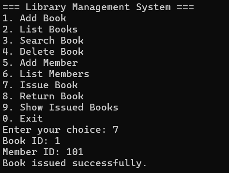
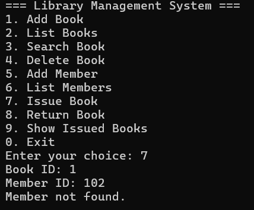
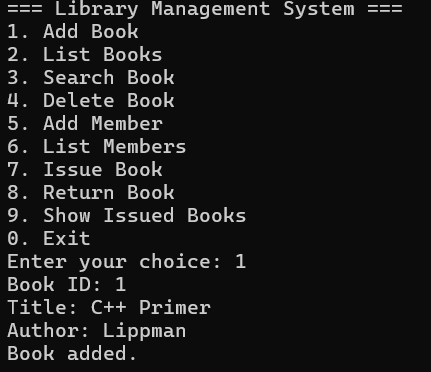
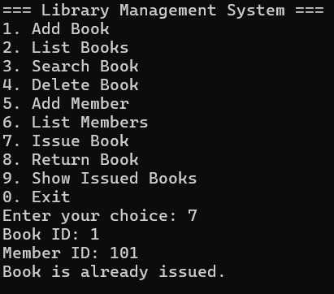
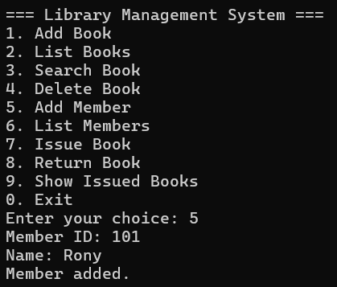
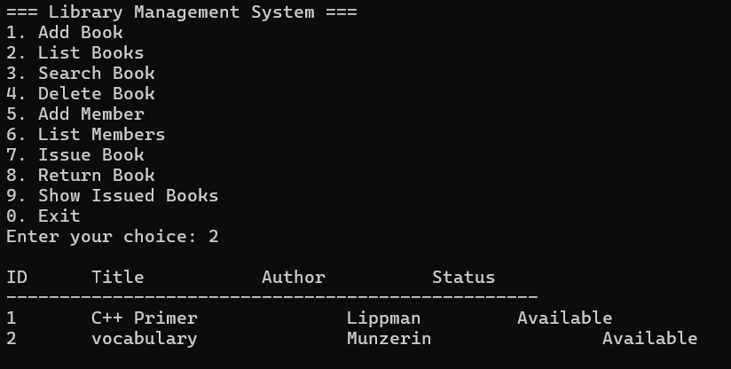
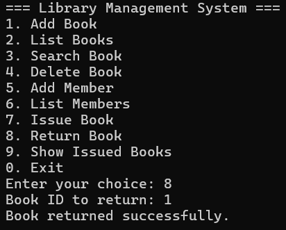
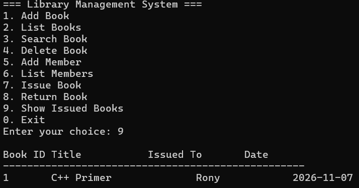

# Library Management System

A console-based Library Management System written in C++ with an SQLite database. It manages books, members and loan records using three related tables.

## Features

- Add, list, search and delete books
- Add and list members
- Issue a book to a member
- Return a book
- Show currently issued books (SQL JOIN across three tables)
- Foreign keys keep loan records consistent

## Technologies Used

- C++
- SQLite 3 (C API)

## Database Design

- books (id, title, author, available)
- members (id, name)
- loans (loan_id, book_id, member_id, issue_date, return_date)

## Screenshots

## How to Run

1. Clone the repository
2. Download the SQLite amalgamation from https://sqlite.org/download.html and place sqlite3.c and sqlite3.h in the project folder
3. Compile SQLite once: gcc -c sqlite3.c -o sqlite3.o
4. Compile the program: g++ main.cpp sqlite3.o -o library_system
5. Run: ./library_system

## Author

Rony - https://github.com/Rony60031
